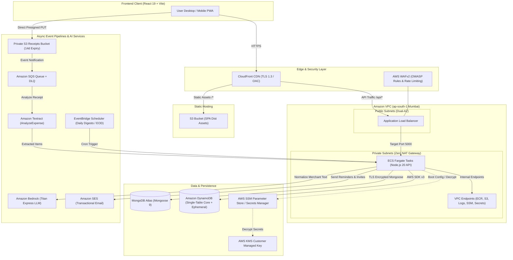

# FinSight Project Technical Report & Architectural Assessment

**Project Title:** FinSight (Cloud-Native Intelligent Personal Finance & Group Splitting Platform)  
**Author / Developer:** Anushree Tiwari ([@anuut1](https://github.com/anuut1))  
**Repositories:** [`anuut1/finSight`](file:///C:/Users/Anushree%20Tiwari/finSight) & [`anuut1/finsight-aws`](file:///C:/Users/Anushree%20Tiwari/finsight-aws)  
**Primary Tech Stack:** React 19, Vite 7, Node.js 20, Express 5, MongoDB Atlas, AWS DynamoDB, Amazon Bedrock, Amazon Textract, Terraform IaC, Docker, AWS ECS Fargate  

---

## 1. Executive Summary

**FinSight** is a production-grade, cloud-native personal finance management and collaborative expense-splitting platform tailored for the modern Indian and international financial ecosystem. Unlike generic expense trackers, FinSight bridges the gap between daily personal budgeting, smart payment alerts (UPI, bank SMS), automated subscription tracking, and complex multi-user group splitting.

### Core Value Propositions
* **AI-Powered Expense Capture:** Automated OCR receipt itemization with [Amazon Textract](file:///C:/Users/Anushree%20Tiwari/finsight-aws/server/services/textractService.js) and GenAI merchant normalization via [Amazon Bedrock](file:///C:/Users/Anushree%20Tiwari/finsight-aws/server/services/bedrockService.js) (Titan Express).
* **Frictionless Ingestion:** Natural language and voice transaction logging alongside a regex and NLP-driven parser for Indian Bank & UPI SMS notifications.
* **Algorithmic Group Splitting:** Sub-cent/integer paise precision accounting for itemized restaurant bills, proportional tax/tip allocations, and greedy bipartite graph debt simplification for settlements.
* **Proactive Subscription Intelligence:** Automatic detection of recurring charges (Netflix, Spotify, Prime, etc.), renewal timeline forecasting, and automated email alerts via [Amazon SES](file:///C:/Users/Anushree%20Tiwari/finsight-aws/server/services/emailService.js).
* **Enterprise-Grade, Cost-Optimized Cloud Infrastructure:** Zero-NAT AWS VPC architecture reducing baseline network infrastructure costs from ~$115/month down to ~$50/month without compromising high availability, security, or private subnet isolation.

---

## 2. System Architecture & Component Topology



---

## 3. Technology Stack Breakdown

| Tier | Technologies / Frameworks | Purpose & Implementation Details |
| :--- | :--- | :--- |
| **Frontend UI** | [React 19](file:///C:/Users/Anushree%20Tiwari/finsight-aws/client/package.json), [Vite 7](file:///C:/Users/Anushree%20Tiwari/finsight-aws/client/vite.config.js), React Router 7, Motion 14, Recharts 3 | Modern responsive single-page application with fluid animations, dynamic data visualization, and glassmorphic styling. |
| **Styling & Icons** | Vanilla CSS3, CSS custom properties, responsive media queries | Custom dark/light theming, clean layout system without heavy third-party CSS dependencies. |
| **Client Utilities** | `qrcode`, `jsqr`, `axios` | Dynamic UPI QR code generation, camera QR scanning, and resilient API communication. |
| **Backend Runtime** | [Node.js 20](file:///C:/Users/Anushree%20Tiwari/finsight-aws/server/package.json), [Express 5](file:///C:/Users/Anushree%20Tiwari/finsight-aws/server/index.js) | High-throughput asynchronous REST API serving JSON contracts, authenticated routes, and health monitoring. |
| **Primary Database** | [MongoDB Atlas](file:///C:/Users/Anushree%20Tiwari/finsight-aws/server/models), Mongoose 9 | Relational-like document modelling for Users, Transactions, Budgets, Goals, Bills, Split Groups, and Receipts. |
| **High-Performance Database** | [Amazon DynamoDB](file:///C:/Users/Anushree%20Tiwari/finsight-aws/server/services/dynamoService.js) | Single-table core schema for fast user profile queries, audit activity logs, recurring subscription templates, and ephemeral TTL sessions. |
| **AI / Machine Learning** | Amazon Bedrock (Titan Text Express v1), Amazon Textract | Natural language transaction cleanup, merchant parsing, and multi-line receipt extraction. |
| **Messaging & Notifications** | Amazon SES, Amazon SNS, Amazon EventBridge | Transactional invites, end-of-day digest reminders, subscription renewal notifications, and budget threshold alarms. |
| **Infrastructure as Code** | [Terraform >= 1.5](file:///C:/Users/Anushree%20Tiwari/finSight/infra) | Modular declarative IaC covering bootstrap state, multi-environment setups (dev/prod), VPC, ECS, ALB, WAF, KMS, and CI/CD. |
| **Containerization** | [Docker](file:///C:/Users/Anushree%20Tiwari/finsight-aws/server/Dockerfile), Amazon ECR | Production-hardened multi-stage container build running as an unprivileged non-root user. |
| **Compute & Orchestration** | AWS ECS Fargate | Serverless container execution with auto-restart, health-checking, and zero server maintenance. |
| **CI / CD Pipelines** | AWS CodePipeline, AWS CodeBuild, GitHub Actions | Automated build, unit/integration testing, Docker image building, ECR vulnerability scanning, and ECS rolling updates. |
| **Testing** | Jest 30, Supertest 7, Vitest 5, Testing Library, Playwright | Multi-level quality assurance spanning unit tests, integration suites, API mocks, and full browser E2E smoke tests. |

---

## 4. Key Functional Modules & Innovations

### 4.1. Algorithmic "Split by Items" & Debt Simplification
* **Paise Precision ([`billCalculator.js`](file:///C:/Users/Anushree%20Tiwari/finsight-aws/server/services/billCalculator.js)):** Financial calculations operate on integer paise (`1 INR = 100 paise`), entirely preventing IEEE 754 floating-point truncation issues common in financial web apps.
* **Proportional Multi-Item Apportionment:** Tax, tip, restaurant service charges, and discounts are distributed proportionally according to each member's individual subtotal.
* **Unclaimed Item Handling:** Flexible policies allow groups to divide unclaimed items equally across all members, absorb them into the payer's share, or flag them for host review.
* **Minimal Cash Flow Settlement ([`splitController.js`](file:///C:/Users/Anushree%20Tiwari/finsight-aws/server/controllers/splitController.js)):** Uses a greedy bipartite graph algorithm to reduce $N$-way group debts down to the theoretical minimum number of transactions, making group reconciliation effortless.
* **Trip Mode ([`TripModeWidget.jsx`](file:///C:/Users/Anushree%20Tiwari/finsight-aws/client/src/components/TripModeWidget.jsx)):** Group travel dashboard with real-time member balance chips, itemized expense creation, receipt attachments, and instant settle-up via UPI deep links.

### 4.2. Smart Transaction Ingestion & Indian Banking Integration
* **Deterministic Bank Alert Engine ([`bankAlertParser.js`](file:///C:/Users/Anushree%20Tiwari/finsight-aws/server/services/bankAlertParser.js)):** Extracts transaction amounts, debit/credit types, merchant names, account trailing digits, and reference numbers from SMS formats used by major institutions (HDFC, ICICI, SBI, Axis, Paytm, PhonePe, Google Pay, Cred).
* **Amazon Bedrock AI Merchant Cleanser ([`bedrockService.js`](file:///C:/Users/Anushree%20Tiwari/finsight-aws/server/services/bedrockService.js)):** Converts cryptographic or noisy UPI strings (e.g., `UPI/4289192837/SWIGGY5281/swiggy@icici`) into clean brand names (`Swiggy`) and auto-categorizes them into `Food & Dining` with confidence metrics.
* **Drafts Review Tray ([`UnconfirmedDraftsDrawer.jsx`](file:///C:/Users/Anushree%20Tiwari/finsight-aws/client/src/components/UnconfirmedDraftsDrawer.jsx)):** Stashes parsed alerts as drafts, enabling users to accept, adjust, or discard transactions with one click.
* **Natural Language & Voice Expense Recording:** Allows free-form inputs like *"Spent 450 on dinner with Rahul yesterday"* to be mapped into structured ledger entries.

### 4.3. Intelligent Subscription & Recurring Payment Management
* **Recurring Pattern Recognition ([`subscriptionService.js`](file:///C:/Users/Anushree%20Tiwari/finsight-aws/server/services/subscriptionService.js)):** Built-in catalog automatically recognizes subscriptions such as Netflix, Spotify, Amazon Prime, Disney+ Hotstar, YouTube Premium, Apple One/iCloud, ChatGPT/Claude AI tools, gym memberships, and broadband providers.
* **Dynamic Cycle Forecasting:** Dynamically calculates next billing dates (monthly vs. annual pricing thresholds) and tracks cumulative subscription expenditures.
* **Automated Renewal Alerts:** Sends personalized email notifications via Amazon SES ahead of debit dates so users can cancel unused services before being charged.

### 4.4. Asynchronous AI Receipt Scanner Pipeline
* **Direct Presigned S3 Uploads ([`s3Service.js`](file:///C:/Users/Anushree%20Tiwari/finsight-aws/server/services/s3Service.js)):** Client uploads images directly to S3 using short-lived presigned URLs, bypassing application servers to preserve memory and network bandwidth.
* **Amazon Textract (`AnalyzeExpense`):** Asynchronously parses raw receipt photos to identify line items, individual prices, sales tax, service charges, and grand totals.
* **Lifecycle Management:** Receipts are kept in a dedicated private bucket configured with a 14-day automatic expiration lifecycle rule to minimize storage costs and comply with data retention hygiene.

---

## 5. Cloud Architecture, Networking & Cost Engineering

### 5.1. Zero-NAT Gateway Network Optimization
Standard AWS VPC architectures deploy NAT Gateways across multiple availability zones to grant private ECS containers outbound internet access, incurring ~$64–$96/month in idle fixed costs. 

FinSight solves this by operating **Zero NAT Gateways**:
* ECS tasks run inside private subnets without public IP addresses.
* Outbound AWS API communication is channeled through **AWS VPC Interface & Gateway Endpoints**:
  * Gateway Endpoint: Amazon S3 (zero cost)
  * Interface Endpoints: AWS ECR (API & DKR), CloudWatch Logs, SSM Parameter Store, AWS Secrets Manager.
* Total network infrastructure cost is compressed to **~$10/month**, yielding a **~70% monthly infrastructure cost reduction**.

### 5.2. Monthly Operating Cost Model (Estimated)

```
+------------------------------------+--------------------------+--------------------+
| Service                            | Dev Configuration        | Estimated Monthly  |
+------------------------------------+--------------------------+--------------------+
| ECS Fargate                        | 1 task (0.25 vCPU, 512MB)| ~$7.20 / mo        |
| Application Load Balancer (ALB)    | 1 Regional ALB           | ~$16.20 / mo       |
| VPC Interface Endpoints            | ECR, Logs, SSM, Secrets  | ~$10.00 / mo       |
| AWS WAFv2                          | 1 Web ACL + 3 rule sets  | ~$5.60 / mo        |
| AWS KMS Customer Managed Key       | 1 CMK (Auto-rotated)     | ~$1.00 / mo        |
| CloudWatch Metrics, Alarms & Logs  | 1 dashboard + 4 alarms   | ~$3.40 / mo        |
| Amazon S3 Storage & Transfer       | 3 Buckets (14-day expiry)| ~$0.60 / mo        |
| Amazon CloudFront CDN              | PriceClass_100 (Free T.) | ~$0.50 / mo        |
| AWS Textract & Amazon Bedrock      | Serverless pay-per-use   | ~$5.50 / mo        |
| Serverless Lambdas & Amazon SQS    | AWS Free Tier            | $0.00              |
+------------------------------------+--------------------------+--------------------+
| TOTAL ESTIMATED MONTHLY SPEND      |                          | ~$50.00 / mo       |
+------------------------------------+--------------------------+--------------------+
```
*(Traditional setups on AWS with standard NAT Gateways and unoptimized configurations routinely cost $115–$150+/month).*

---

## 6. Data Architecture: Dual-Database Strategy

FinSight implements a strategic dual-database model combining the query flexibility of document stores with the single-digit millisecond latency of a NoSQL key-value store.

### 6.1. Primary Store: MongoDB Atlas
* **Data Model:** Highly structured, nested document models ([`Bill.js`](file:///C:/Users/Anushree%20Tiwari/finsight-aws/server/models/Bill.js), [`SplitGroup.js`](file:///C:/Users/Anushree%20Tiwari/finsight-aws/server/models/SplitGroup.js), [`Transaction.js`](file:///C:/Users/Anushree%20Tiwari/finsight-aws/server/models/Transaction.js), [`User.js`](file:///C:/Users/Anushree%20Tiwari/finsight-aws/server/models/User.js)).
* **Transactions & Consistency:** ACID multi-document transactions ensure balance changes, bill finalization, and debt settlement records remain atomic.

### 6.2. High-Performance Store: DynamoDB Single-Table Design
Implemented in [`dynamoService.js`](file:///C:/Users/Anushree%20Tiwari/finsight-aws/server/services/dynamoService.js) and [`dynamoClient.js`](file:///C:/Users/Anushree%20Tiwari/finsight-aws/server/services/dynamoClient.js):

| Entity | Partition Key (PK) | Sort Key (SK) | GSI1 Partition Key (GSI1PK) | GSI1 Sort Key (GSI1SK) | Description |
| :--- | :--- | :--- | :--- | :--- | :--- |
| **User Profile** | `USER#<userId>` | `PROFILE` | `EMAIL#<email>` | `USER#<userId>` | Fast user lookup by ID or unique email. |
| **Activity Log** | `USER#<userId>` | `ACT#<timestamp>#<action>` | — | — | Time-series audit trails of logins, edits, and settlements. |
| **Subscription** | `USER#<userId>` | `SUB#<templateId>` | — | — | Cached recurring subscription templates for instant dashboard loading. |
| **Ephemeral Session** | `SESSION#<sessionId>` | `TOKEN` | — | — | Stored in ephemeral table with native DynamoDB TTL for automatic cleanup. |

---

## 7. Security, Governance & Compliance Posture

* **Defense in Depth:**
  * **Edge:** CloudFront enforces HTTPS (TLS 1.3), blocking unencrypted traffic.
  * **WAF Layer:** AWS WAFv2 shields the ALB from layer-7 denial of service (rate limiting to 500 requests per 5 minutes per IP) and applies AWS Managed Common Core Rule Sets (OWASP Top 10 mitigation).
  * **Application Perimeter:** Express utilizes [Helmet](file:///C:/Users/Anushree%20Tiwari/finsight-aws/server/index.js#L59) to set strict HTTP security headers, CORS origin verification (matching authorized production origins only), and a 1MB payload ceiling.
* **Zero Hardcoded Secrets:**
  * Application secrets (`MONGO_URI`, `JWT_SECRET`, `CLIENT_URL`) are stored in AWS SSM Parameter Store as `SecureString` or AWS Secrets Manager.
  * Encrypted at rest using a dedicated AWS KMS Customer Managed Key (CMK) with automated key rotation.
* **Least Privilege IAM:**
  * Separate ECS Execution Roles (ECR pull, CloudWatch log streams) and ECS Task Roles (S3 read/write, SSM decrypt, SES send).
  * No long-lived AWS IAM credentials stored in code or deployed images.
* **CI/CD Security Gates:**
  * AWS CodeBuild automatically scans newly compiled container images for CVE vulnerabilities and fails builds upon detecting `CRITICAL` issues.

---

## 8. Quality Assurance & Testing Matrix

FinSight features comprehensive test coverage spanning all architectural layers:

```
finsight-aws/
├── server/tests/ (26 Test Suites)
│   ├── auth.test.js & authMiddleware.test.js       # JWT lifecycle, token validation, rate-limiting
│   ├── billCalculator.test.js                      # Proportional taxes, tips, unclaimed item edge cases
│   ├── bills.test.js & splitAccess.test.js          # Item claim validation, access control matrices
│   ├── settleUpEndToEnd.test.js                    # Minimal cash flow settlement validation
│   ├── textractService.test.js & errorMapping      # Textract OCR parsing and fallback heuristics
│   ├── subscriptionService.test.js                 # Subscription detection and next-due date math
│   ├── dynamoService.test.js                       # DynamoDB single-table CRUD and query operations
│   └── e2eTripReceipts.test.js                     # End-to-end trip creation, receipt scan, and split
├── client/src/tests/ (13 Test Suites)
│   ├── ItemClaimModal.test.jsx                     # Interactive item claim selection & totals
│   ├── TripAddExpenseModal.test.jsx                # Multi-payer trip expense form validation
│   ├── ReceiptScannerBox.test.jsx                  # Direct upload and OCR loading state handling
│   ├── SettleUpFlow.test.jsx                       # UPI modal triggers and debt settlement confirmation
│   └── useReceiptScan.test.jsx                     # Reusable scan pipeline hook lifecycle
└── e2e/
    └── smoke.spec.js                               # Playwright multi-page browser smoke suite
```

---

## 9. Repository Analysis: `finSight` vs `finsight-aws`

During inspection of your workspace, two related repositories were analyzed:

| Attribute | `anuut1/finSight` | `anuut1/finsight-aws` |
| :--- | :--- | :--- |
| **Path** | [`C:\Users\Anushree Tiwari\finSight`](file:///C:/Users/Anushree%20Tiwari/finSight) | [`C:\Users\Anushree Tiwari\finsight-aws`](file:///C:/Users/Anushree%20Tiwari/finsight-aws) |
| **Primary Focus** | Complete Infrastructure as Code (Terraform), bootstrap scripts, Cloudflare worker experiments, and initial monorepo. | Active AWS deployment repository containing refined root `client` and `server` folders. |
| **DynamoDB Single-Table** | Not present | **Fully implemented** ([`dynamoService.js`](file:///C:/Users/Anushree%20Tiwari/finsight-aws/server/services/dynamoService.js), [`inspectDynamo.js`](file:///C:/Users/Anushree%20Tiwari/finsight-aws/server/scripts/inspectDynamo.js), [`syncToDynamo.js`](file:///C:/Users/Anushree%20Tiwari/finsight-aws/server/scripts/syncToDynamo.js)) |
| **Subscription Engine** | Basic templates | **Intelligent Subscription Detector** with automated SES renewal notifications |
| **CI/CD Buildspecs** | Monorepo-nested `buildspec.yml` | Dedicated [`buildspec.yml`](file:///C:/Users/Anushree%20Tiwari/finsight-aws/buildspec.yml) (backend Docker) + [`buildspec-frontend.yml`](file:///C:/Users/Anushree%20Tiwari/finsight-aws/buildspec-frontend.yml) (S3/CloudFront sync) |
| **Commit Horizon** | Up to commit `ee46dad` | **Most recent commit `5240df2`** (restricted DynamoDB inspector) |

---

## 10. Strategic Recommendations & Roadmap

1. **Unify Repositories / Submodules:**
   * Migrate the mature Terraform modules from `finSight/infra` directly into `finsight-aws/infra` so that infrastructure definitions and application code reside in a single coherent repository.
2. **Automated End-to-End Synthetic Monitoring:**
   * Integrate the Playwright smoke tests into the AWS CodePipeline post-deployment phase to run automated headless UI verifications immediately after static assets sync to S3.
3. **Progressive Web App (PWA) Offline Sync:**
   * Add a Service Worker with background sync for offline expense drafting during travel when cellular connectivity is spotty.
4. **Multi-Currency Support for International Travel:**
   * Expand `billCalculator.js` to support foreign currencies alongside INR, pulling real-time exchange rates for foreign trip expense logs.

---

## 11. References & Academic Bibliography

The design, mathematical formulations, and cloud-native architecture of FinSight are grounded in the following peer-reviewed academic literature, industry standards, and official architectural whitepapers:

### Financial Computation & Precision Arithmetic
1. **Goldberg, D. (1991).** *What Every Computer Scientist Should Know About Floating-Point Arithmetic.* ACM Computing Surveys (CSUR), 23(1), 5–48. DOI: [10.1145/103162.103163](https://doi.org/10.1145/103162.103163). *(Theoretical basis for avoiding IEEE 754 floating-point drift and adopting integer paise precision).*
2. **IEEE Computer Society. (2019).** *IEEE Standard for Floating-Point Arithmetic (IEEE Std 754-2019).* IEEE Standards Association. DOI: [10.1109/IEEESTD.2019.8766229](https://doi.org/10.1109/IEEESTD.2019.8766229).

### Graph Algorithms & Debt Minimization
3. **Cormen, T. H., Leiserson, C. E., Rivest, R. L., & Stein, C. (2022).** *Introduction to Algorithms* (4th ed.). MIT Press. Chapter 24: Single-Source Shortest Paths & Chapter 26: Maximum Flow. *(Algorithmic foundation for greedy bipartite cash-flow simplification in split reconciliation).*
4. **West, D. B. (2001).** *Introduction to Graph Theory* (2nd ed.). Prentice Hall. *(Bipartite matching and graph transaction reduction).*

### Cloud Computing & Distributed Systems
5. **Amazon Web Services. (2024).** *AWS Well-Architected Framework: Reliability, Performance Efficiency, and Cost Optimization Pillars.* AWS Whitepapers. [AWS Documentation](https://docs.aws.amazon.com/wellarchitected/). *(Zero-NAT VPC topology and multi-AZ resilience).*
6. **DeCandia, G., et al. (2007).** *Dynamo: Amazon’s Highly Available Key-value Store.* ACM SIGOPS Operating Systems Review, 41(6), 205–220. DOI: [10.1145/1323293.1294281](https://doi.org/10.1145/1323293.1294281). *(Underlying single-table design principles for Amazon DynamoDB).*
7. **Vogels, W. (2009).** *Eventually Consistent: Building Distributed Systems at Scale.* Communications of the ACM, 52(1), 40–44. DOI: [10.1145/1435417.1435432](https://doi.org/10.1145/1435417.1435432).

### Artificial Intelligence & Document OCR
8. **Amazon Web Services. (2024).** *Amazon Textract Developer Guide: Analyzing Invoices and Receipts with the AnalyzeExpense API.* AWS Documentation. [Textract Guide](https://docs.aws.amazon.com/textract/latest/dg/invoices-receipts.html).
9. **Vaswani, A., et al. (2017).** *Attention Is All You Need.* Advances in Neural Information Processing Systems (NeurIPS 2017), 30, 5998–6008. *(Transformer architecture leveraged by Amazon Bedrock Titan LLMs).*

### Web Application Engineering, Security & Cryptography
10. **React Core Team. (2024).** *React 19 Technical Documentation: Server Components, Transitions, and Context Optimization.* Meta Platforms Inc. [React Docs](https://react.dev).
11. **Chodorow, K. (2013).** *MongoDB: The Definitive Guide: Powerful and Scalable Data Storage* (2nd ed.). O'Reilly Media. *(Schema design and subdocument indexing in Mongoose).*
12. **Jones, M., Bradley, J., & Sakimura, N. (2015).** *JSON Web Token (JWT).* IETF RFC 7519. DOI: [10.17487/RFC7519](https://doi.org/10.17487/RFC7519).
13. **Provos, N., & Mazières, D. (1999).** *A Future-Adaptable Password Scheme.* Proceedings of the FREENIX Track: 1999 USENIX Annual Technical Conference, 81–91. *(bcrypt password security).*
14. **Open Web Application Security Project. (2023).** *OWASP Top Ten Web Application Security Risks.* OWASP Foundation. [OWASP Top 10](https://owasp.org/www-project-top-ten/).

---
*Report updated with academic references on 2026-10-27.*
