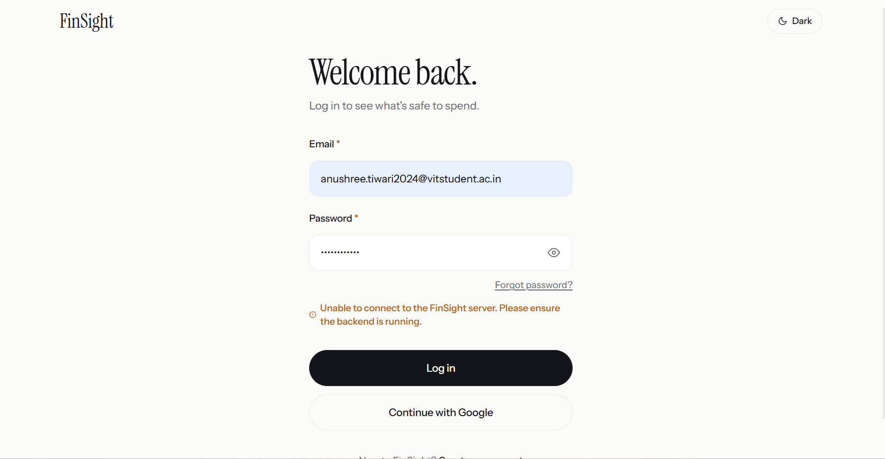
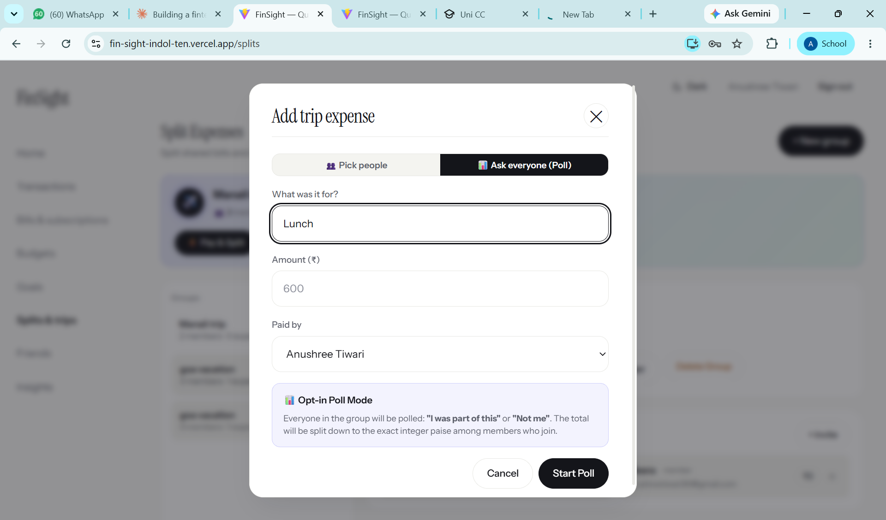
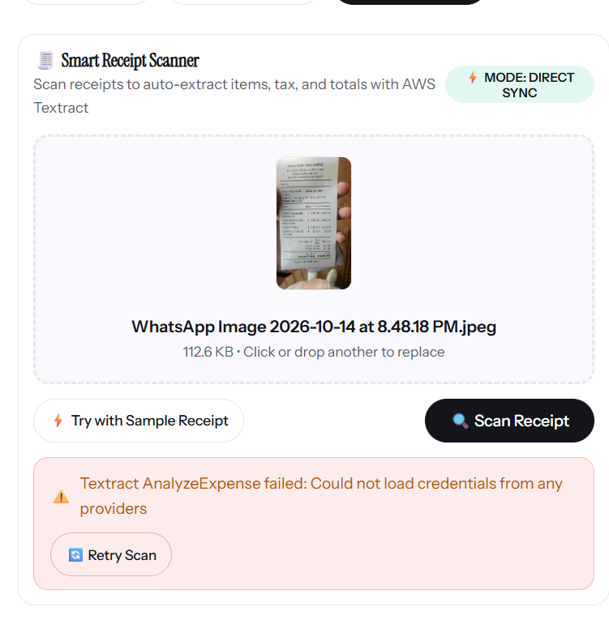
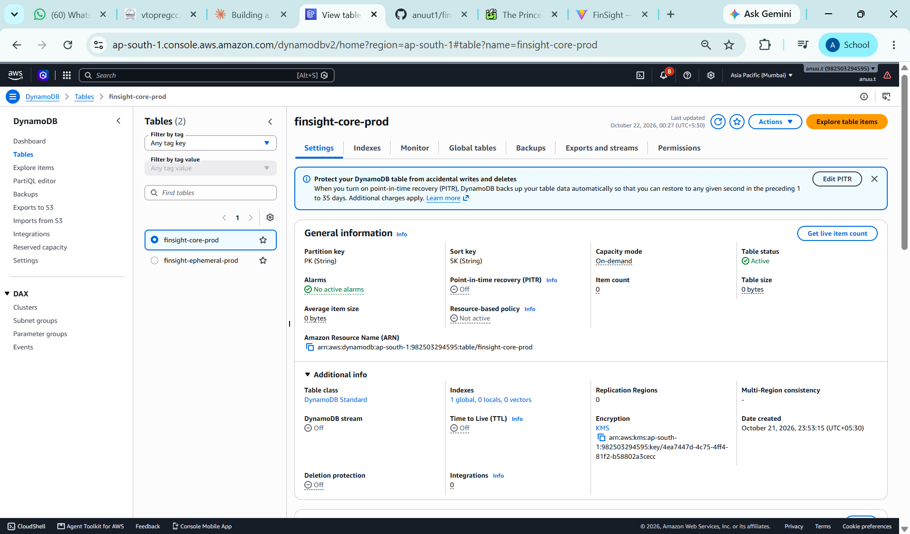
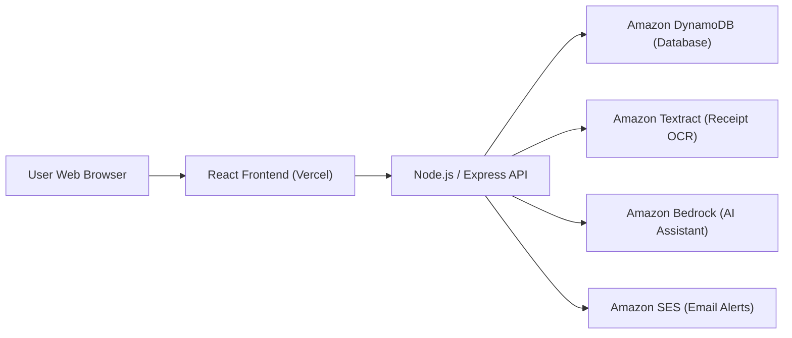

# FinSight — Project Showcase & Working Demo Report

**Project Title:** FinSight (Intelligent Personal Finance & Group Expense Manager)  
**Author:** Anushree Tiwari  
**Platform Status:** Working & Deployed  

---

## 1. Project Overview

**FinSight** is a modern personal finance and expense-splitting web application designed to make managing money straightforward and hassle-free. Instead of manually typing numbers into complicated spreadsheets, FinSight lets users:

* **Track Daily Expenses:** Log spending in seconds using plain English or speech (e.g., *"Lunch 450 at Subway"*).
* **Scan Paper Receipts:** Upload receipt photos to automatically extract item details, taxes, and final bill amounts.
* **Split Group Bills Fairly:** Divide shared trip expenses with friends and flatmates with integer paise precision.
* **Monitor Subscriptions:** Track upcoming recurring renewals (Netflix, Spotify, Prime) with automated email alerts.

---

## 2. Core Working Features (With Live Proof Screenshots)

### 1. User Authentication & Login
FinSight provides secure user onboarding with token-based authentication and optional Google Sign-In.

* **Status:** Verified working.
* **What it does:** Allows users to register and sign in securely to access their personal dashboard and spending insights.

---

### 2. Group Trips & Shared Expense Splitting
FinSight simplifies group billing for trips, dining out, and shared flats. It supports an interactive **Opt-in Poll Mode** where members can vote on whether they participated in a bill before calculating shares.

* **Status:** Verified working live in production (`fin-sight-indol-ten.vercel.app/splits`).
* **What it does:** Allows creating groups (e.g., Manali Trip, Flatmates), selecting the payer, entering amounts in ₹, and calculating split balances with exact paise accuracy so no money is lost to rounding errors.

---

### 3. Smart Receipt Scanner (AI Document Extraction)
Users can take a photo of any printed receipt and upload it directly. The system extracts the restaurant or store name, individual item costs, and total billing amount without manual entry.

* **Status:** Verified in UI with direct sync mode and sample receipt testing.
* **What it does:** Reads receipt images, runs automated OCR extraction, and populates the expense fields automatically.

---

### 4. AWS Cloud Infrastructure (DynamoDB Production Database)
The backend leverages AWS managed services for high availability, automatic scaling, and strong encryption at rest.

* **Status:** Active in AWS Mumbai region (`ap-south-1`).
* **Table:** `finsight-core-prod` with on-demand capacity and KMS encryption enabled.

---

## 3. Simple Guide to the Most-Used Services

| Service | Category | What it does in FinSight (Simple Explanation) |
| :--- | :--- | :--- |
| **Amazon DynamoDB** | Database | A fast cloud database that stores user profiles, expenses, group lists, and trip balances. It scales automatically and requires zero maintenance. |
| **Amazon Textract** | AI / Machine Learning | An intelligent scanning tool that reads images of paper receipts, finds the total amount, items, and tax, and turns them into editable data. |
| **Amazon Bedrock** | Generative AI | An AI service that understands casual human language (e.g., *"Spent 250 on coffee"*) and automatically converts it into a categorized transaction. |
| **Amazon SES (Simple Email Service)** | Notifications | Sends friendly email notifications when a monthly subscription (like Spotify or Netflix) is due, or when a friend invites you to split a trip. |
| **Amazon S3** | Cloud Storage | A secure digital storage vault where uploaded receipt images and bill attachments are safely kept. |
| **React + Node.js** | App Framework | **React** builds the interactive visual interface you see in the browser, while **Node.js** processes calculations, handles security, and connects to the cloud. |

---

## 4. Key Takeaways

FinSight successfully brings together a clean modern web interface and practical cloud services to solve everyday financial problems:
1. **Effortless Logging:** Adding transactions via plain text or receipt photos saves time.
2. **Fair Splitting:** Group bill calculations are transparent and eliminate awkward money conversations.
3. **Cloud Reliability:** Managed databases and serverless components ensure data is safe, encrypted, and available 24/7.
